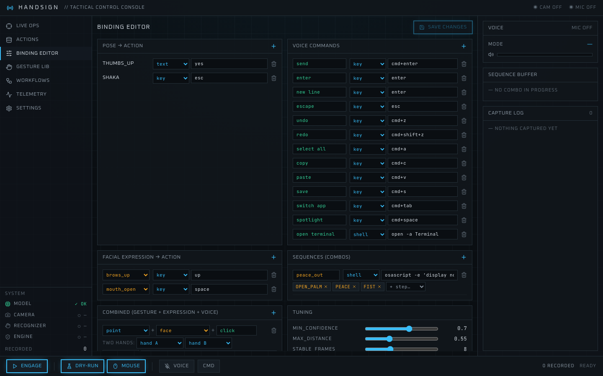
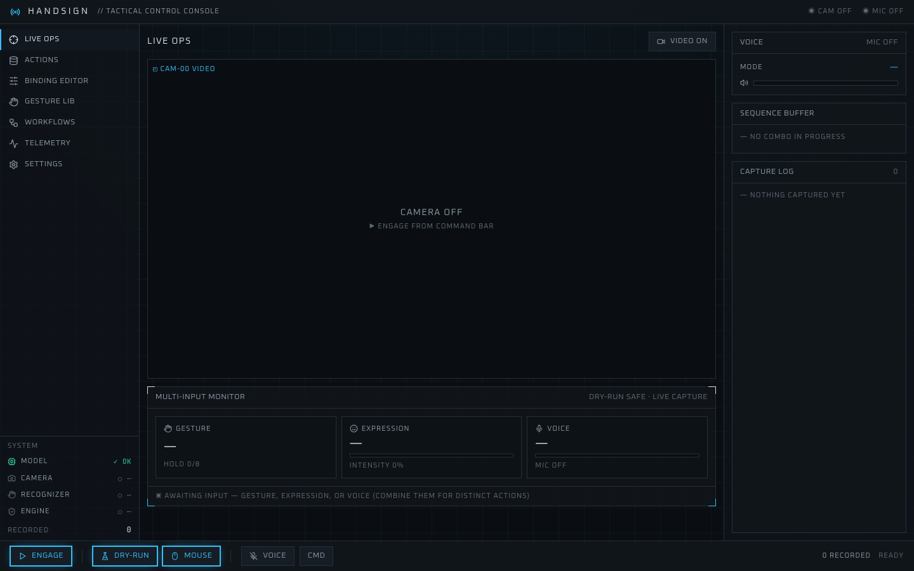

# handsign

<!-- HERO: GIF of steering the cursor with a finger — Rishabh to add docs/images/hero.gif -->

Control your Mac with hand signs, facial expressions and your voice, using only a camera and a microphone.

*A proof of concept, shared to show the work. macOS only.*

## How it works

1. **The browser captures.** The control console, a web page on `http://127.0.0.1:8000`, opens your camera and microphone with `getUserMedia`. macOS won't hand them to a background program, so the browser does it.
2. **It streams to a local recogniser.** Video frames and spoken phrases go over a WebSocket to a Python server on the same Mac. It finds hands and a face with MediaPipe and transcribes speech with faster-whisper. Camera and microphone data never leave the machine.
3. **Poses, expressions and phrases are matched.** A hand pose has to hold steady for a few frames before it counts. Sequences and combos are checked on top of that.
4. **Bindings fire actions.** A key press, typed text, a shell command, a mouse click or a multi-step workflow. Start in **Dry-Run** (the default) to see what would fire without firing it.

## What it does

- **Hand poses.** Seven are built in and work with no setup: fist, open palm, thumbs up, point, peace, three and shaka. Record any other pose from a few seconds of video in the Gesture Library.
- **Two hands.** Each hand is tracked on its own, and two-hand combos are bindings too (for example, fist + open palm).
- **Sequences.** An ordered chain of poses fires an action, like seals in a row. The default config has one made of built-in poses (open palm, peace, fist).
- **Facial expressions.** Twelve, read from MediaPipe's face blendshapes: smile, mouth open, brows up, brows down, frown, pucker, cheek puff, tongue out, wink left, wink right, jaw left, jaw right. Use one alone or with a pose (thumbs up + smile).
- **Voice.** Speech is transcribed on the Mac. Say a command, or switch to dictation and it types what you say. A binding can require a pose and a phrase together (point + "click").
- **Mouse control.** Hold the point pose and your fingertip moves the cursor. Pinch thumb and index to click, or hold the pinch to drag. Hold the scroll pose (three by default) and move your hand up and down to scroll.
- **Workflows.** Named macros: several steps, with optional delays, from one trigger.
- **Dry run.** Shows what would fire, without doing it.
- **Command-line runner.** `./handsign.sh run` does the same job without a browser, and adds push-to-talk (hold a pose, speak, let go). It opens the camera itself.

## What's in the repo

```
handsign/       Python recogniser and local server (FastAPI, MediaPipe, faster-whisper)
web/            the control console (Vite, React, Tailwind)
gestures.json   default bindings, built-in poses only
examples/       naruto.json, a sequence that needs your own recordings
scripts/        download_models.sh, check_origin_guard.sh
tests/          origin-guard and config-API tests
docs/images/    console screenshots
setup.sh        one-command setup
handsign.sh     launcher (uses the in-repo .venv)
```

The two MediaPipe model files are not in the repo. `setup.sh` downloads them into `data/`.

## How to try it

You need a Mac, Python 3.11 or newer, and Node.js 18 or newer.

```bash
./setup.sh              # .venv, Python deps, web console build, models
./handsign.sh console   # then open http://127.0.0.1:8000
```

If the terminal prints `Class AVFFrameReceiver is implemented in both ...` warnings at startup, ignore them: OpenCV and PyAV (used by faster-whisper) each bundle FFmpeg, and the console never opens the camera from Python.

In the console, press **Engage** and allow the camera in your browser. Make a pose and Live Ops shows what the binding "would fire". That is Dry-Run. Turn Dry-Run off to let bindings act for real. Changes you save in the editors apply the next time you press Engage or Voice. The **Run** button on a workflow is always a real run and asks first; Dry-Run doesn't cover it.

The console shows:

- **Live Ops**, the live view with the hand mesh and the pose it recognises;
- **Actions** and **Binding Editor**, which edit `gestures.json` visually;
- **Gesture Lib**, to record your own poses;
- **Workflows**, to build macros.




### Permissions (macOS, one time)

- **Camera and Microphone.** Your browser asks the first time you engage. Allow `127.0.0.1`.
- **Accessibility**, for the terminal app that runs the server (System Settings, Privacy & Security). Without it, key presses and mouse moves can't reach other apps. Dry-Run doesn't need it.
- For the command-line runner, give the terminal Camera and Microphone access too.

### Network use

Everything is processed locally. Two things are fetched from the internet: the console loads two fonts from Google Fonts, and the first time you press Voice, faster-whisper downloads the `base.en` speech model (about 150 MB, then cached; the Voice card says "loading speech model" while it does).

### Working on the console

Run the server (`./handsign.sh console`) and, in another terminal, `cd web && npm run dev`. The UI is then on `http://127.0.0.1:5173` with hot reload, and it proxies `/api` and `/ws` to the server on port 8000. `npm test` (in `web/`) runs the config-editing tests.

### Try the Naruto seals

Record snake, ram, monkey, boar, horse and tiger in the Gesture Library (a few seconds each, from a few angles), then:

```bash
cp examples/naruto.json gestures.json
```

Inspired by Naruto. Not affiliated.

## Security: bindings can run shell commands

A `shell` action runs whatever command it holds, as you. Treat `gestures.json` like a script, and only bind commands you understand. The console can edit bindings (`PUT /api/config`), so the server is locked down:

- it listens on `127.0.0.1` only;
- it accepts requests only from its own console origins (`localhost` or `127.0.0.1` on the server port, and Vite's port 5173 for development);
- any HTTP or WebSocket request with a foreign `Origin` header is refused with 403, and the `Host` header must be a loopback name, so a web page you happen to have open can't reach it.

Other programs running on your Mac as you can still talk to it, as they could run commands anyway. Check the guard yourself with `./scripts/check_origin_guard.sh`, or `.venv/bin/python -m unittest discover tests`.

## What isn't done

- The **Telemetry** and **Settings** pages in the console are placeholders ("Module Offline").
- Push-to-talk works in the command-line runner only. The console has command and dictation modes instead.
- macOS only. It has been run on one Mac and isn't tested on others, and it isn't packaged as an app.
- Recognition is simple: built-in poses use finger geometry, recorded poses use nearest-neighbour matching. Expect to tune thresholds with `./handsign.sh calibrate`.

## Credits

Built on MediaPipe, faster-whisper and others. See [NOTICE](NOTICE) for third-party pieces and their licences.

Shared to show the work. All rights reserved. Please ask before reusing any of it.
